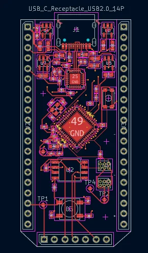
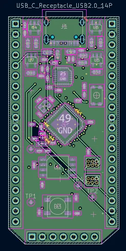
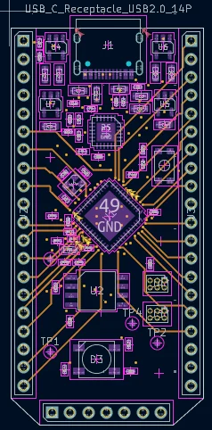
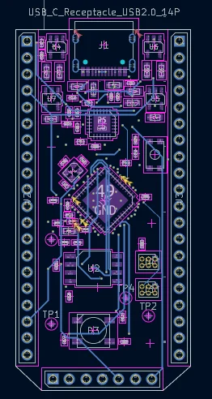

# NorthernStudios iCE40-UltraPlus FPGA Dev Board (V2)

  

  <b>Designed by: Muhammad Uzzam Butt // Made for Macondo</b>

  
  
  

---

## Overview
**NorthernStudios iCE40-UltraPlus FPGA Dev Board (V2)** is a small, open-source development board based on the tiny form factor that utilizes **Lattice iCE40 UltraPlus (iCE40UP5K)** FPGA. This development board is specially built for the **Hack Club Macondo** for low power edge computing, TinyML, RISC-V softcores and hardware developments.

The features of this development board include the integrated USB-to-UART bridge, 128M-bit SPI Flash and the multi rail power supply system.

---

##  Hardware Specifications

### FPGA Chip: Lattice iCE40UP5K
* **Logic Cells**: 5,280 Look-Up Tables (LUTs)
* **Block RAM (BRAM)**: 120 Kbit
* **Single-Port RAM (SPRAM)**: 1,024 Kbit (128 KB, ideal for microcontroller program memory)
* **DSP Blocks**: 8 (16x16 multiplier + 32-bit accumulator)
* **Hardened IP**: 2x I2C, 2x SPI
* **Constant Current Drivers**: 3x 24mA dedicated driver outputs (suited for RGB LED control)

### Important components
| Component | Function | Description |
| :--- | :--- | :--- |
| **FPGA** | [Lattice iCE40UP5K-SG48ITR](https://www.latticesemi.com/Products/FPGAandCPLD/iCE40UltraPlus) | SG48 package, 48-pin QFN, highly integrated low-power FPGA. |
| **USB-to-UART Bridge** | [Silicon Labs CP2102N](https://www.silabs.com/interface/usb-bridges/usbtouart/device.cp2102n-a02-gqfn24) | High-speed USB-to-UART bridge for programming and serial debugging via USB-C. |
| **SPI Flash** | Winbond W25Q128JVS (128M-bit / 16MB) | Stores FPGA configuration bitstreams and extra user data or filesystem blocks. |
| **Reference Oscillator** | Seiko Epson SG-210STF (12 MHz) | Ultra-precise active crystal oscillator providing a stable system reference clock. |
| **Power Regulators** | Diodes Inc. AP2112K LDOs | Generates +1.2V (Core), +1.8V (PLL/VCC), +2.5V (Auxiliary), and +3.3V (I/O & Flash) from USB +5V. |
| **USB Connector** | USB Type-C Receptacle (14-Pin) | Handles 5V power supply, programming interface, and UART communications. |

---

##  Onboard Interfaces & I/O
* **RGB LED**: Dedicated addressable RGB LED (LED_ARGB) connected to the FPGA's constant current outputs for status and visualization.
* **User I/O**: Multi-pin expansion breakout headers featuring standard 0.1" pitch GPIO pins.
* **Tactile Buttons**:
  * Reset Button
  * User Programmable Button

---

## PCB Design & Layers

This PCB is designed as a high-density, **4-layer board** utilizing KiCad to ensure clean signal routing, stable ground planes, and dedicated power rails. 

###  Outer Silkscreen & Soldermask
* **Front View (Main Thumbnail)**:
  
* **Back View**:
  

###  Internal Copper Layers
* **Layer 1 (L1 - Top Copper / Signals)**:
  
* **Layer 2 (L2 - Inner Ground Plane)**:
  
* **Layer 3 (L3 - Inner Power Plane)**:
  
* **Layer 4 (L4 - Bottom Copper / Signals)**:
  

---

## Bill of Materials (BOM)

The complete bill of materials for the board is listed below. You can also view the raw CSV file [bom.csv](file:///D:/NS%20FPGA%20V2/NS%20FPGA%20V2%20iCE/jlcpcb/production_files/bom.csv).

| Comment | Designator | Footprint | LCSC | Quantity |
| :--- | :--- | :--- | :--- | :--- |
| 0.1uF | C10,C11,C14,C18,C19,C20,C21,C22,C23,C24,C26 | C_0402_1005Metric | C141382 | 11 |
| 1.5k | R12,R13,R14,R17 | R_0402_1005Metric | C25867 | 4 |
| 100 | R8 | R_0603_1608Metric | C22775 | 1 |
| 100nF | C15,C17 | C_0402_1005Metric | C1525 | 2 |
| 10k | R10,R11,R15,R16,R6,R7 | R_0402_1005Metric | C25531 | 6 |
| 10uF | C16 | C_0402_1005Metric | C15525 | 1 |
| 10uF | C1,C2,C3,C4,C5,C6,C7,C8 | C_0603_1608Metric | C19702 | 8 |
| 1k | R1 | R_0402_1005Metric | C25543 | 1 |
| 1uF | C25 | C_0402_1005Metric | C52923 | 1 |
| 22.1k | R5 | R_0402_1005Metric | C43473 | 1 |
| 4.7uF | C12,C13,C9 | C_0402_1005Metric | C23733 | 3 |
| 47.5k | R4 | R_0402_1005Metric | C137974 | 1 |
| 5.1k | R2,R3 | R_0603_1608Metric | C23186 | 2 |
| AP2112K-1.2 | U5 | SOT-23-5 | C460310 | 1 |
| AP2112K-1.8 | U7 | SOT-23-5 | C3021123 | 1 |
| AP2112K-2.5 | U6 | SOT-23-5 | C49451993 | 1 |
| AP2112K-3.3 | U4 | SOT-23-5 | C51118 | 1 |
| CP2102N-Axx-xQFN24 | U3 | QFN-24-1EP_4x4mm_P0.5mm_EP2.6x2.6mm | C969151 | 1 |
| D_Schottky | D1 | D_0603_1608Metric | C6770543 | 1 |
| ICE40UP5K-SG48ITR | U1 | QFN-48-1EP_7x7mm_P0.5mm_EP5.1x5.1mm | C2678152 | 1 |
| LED | D2,D4 | LED_0402_1005Metric | C130723 | 2 |
| LED_ARGB | D3 | LED_RGB_Wuerth-PLCC4_3.2x2.8mm_150141M173100 | C7288905 | 1 |
| R22 | R9 | R_0402_1005Metric | C25092 | 1 |
| SG-210STF | Y1 | Oscillator_SMD_SeikoEpson_SG210-4Pin_2.5x2.0mm | C728996 | 1 |
| SW_Push | SW1 | SW_Push_1P1T_NO_CK_KMR2 | C221679 | 1 |
| USB_C_Receptacle_USB2.0_14P | J1 | USB_C_Receptacle_HRO_TYPE-C-31-M-12 | C2894897 | 1 |
| W25Q128JVS | U2 | SOIC-8_5.3x5.3mm_P1.27mm | C97521 | 1 |
| Conn_02x03_Odd_Even | J5 | PinHeader_2x03_P1.00mm_Vertical | | 1 |
| Conn_02x03_Odd_Even | J4 | PinHeader_2x03_P1.00mm_Vertical | | 1 |
| TestPoint_Small | TP4 | TestPoint_Pad_D1.0mm | | 1 |
| TestPoint_Small | TP3 | TestPoint_Pad_D1.0mm | | 1 |
| TestPoint_Small | TP2 | TestPoint_Pad_D1.0mm | | 1 |
| TestPoint_Small | TP1 | TestPoint_Pad_D1.0mm | | 1 |
| Conn_01x07_Pin | J6 | PinHeader_1x07_P2.54mm_Vertical | | 1 |
| Conn_01x20_Pin | J3 | PinHeader_1x20_P2.54mm_Vertical | | 1 |
| Conn_01x20_Pin | J2 | PinHeader_1x20_P2.54mm_Vertical | | 1 |

---

## Getting Started

### 💻 Open Source Toolchain Setup
The Lattice iCE40 UltraPlus is fully supported by the open-source FPGA toolchain, providing quick compilation and programming:

1. **Synthesis**: [Yosys](https://github.com/YosysHQ/yosys)
2. **Place & Route**: [nextpnr](https://github.com/YosysHQ/nextpnr) (using target `--up5k`)
3. **Bitstream Packing**: [icepack](https://github.com/YosysHQ/icestorm)
4. **Programming**: [iceprog](https://github.com/YosysHQ/icestorm)

*Note: You can also use Lattice's IDE **Lattice Radiant** or **iCEcube2**.*

---

##  License

This project is licensed under the **MIT License**. For details, see the [LICENSE](LICENSE) file.
